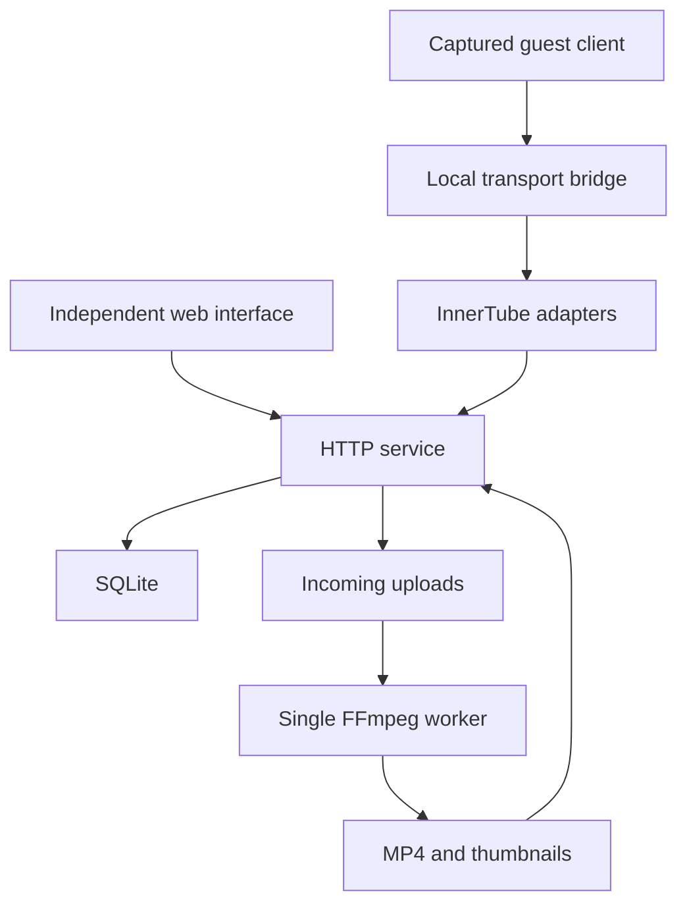

# Architecture

The Python standard-library service avoids a package installation dependency. SQLite uses WAL and foreign keys; state-changing responses are sent only after the transaction commits. Sessions are random tokens, hashed in storage, in HttpOnly/SameSite cookies, with Secure set for HTTPS origins. All writes require a custom same-origin header; supplied Origin headers must match `PUBLIC_ORIGIN` exactly. No permissive CORS response is sent.

Uploaded videos are streamed to disk instead of buffering the entire request. A single worker processes persisted `processing` rows and retries them after a restart. It probes the input, limits duration, transcodes H.264/AAC progressive MP4 with faststart, and generates a JPEG. Playlist formats and network protocols are excluded. This is a small-instance design; HTTP concurrency is capped at 32 connections and pending upload slots are reserved atomically; global disk quotas and stricter transcoder isolation still need further work before large untrusted deployments.

Media requests resolve only generated 11-character IDs and two known filenames. A ready database record is required before bytes are served. Range requests support exact, open-ended and suffix ranges; invalid ranges return 416. The independent UI uses native video controls and escaped text for user content.

Captured assets are instance-local. Only a fixed YouTube static-path allowlist is downloaded. Filenames are content-addressed by source URL; source/served content hashes are recorded separately. Dynamic requests can fetch only validated immutable paths from the fixed public YouTube build host and the observed fonts.gstatic.com /s/i/ and www.gstatic.com /youtube/img/icons/ families, with strict file/count/cache limits and no forwarded credentials. Guest home and watch templates are captured separately. A view-preference cookie retains the captured client across full navigations, with an explicit independent-UI exit. The shell replaces `ytInitialData` and watch player bootstrap data with local content; the bridge changes fetch/XHR to local APIs. CSP prevents external network access even if an unadapted client path tries to reach Google. Missing operations produce 501 and operator-visible counters instead of invented success responses.

These adapters deliberately do not forward authentication to Google or use upstream YouTube content. All uploads, accounts and interactions belong to this instance. The official client's local authentication and mutation flows still require protocol work.
